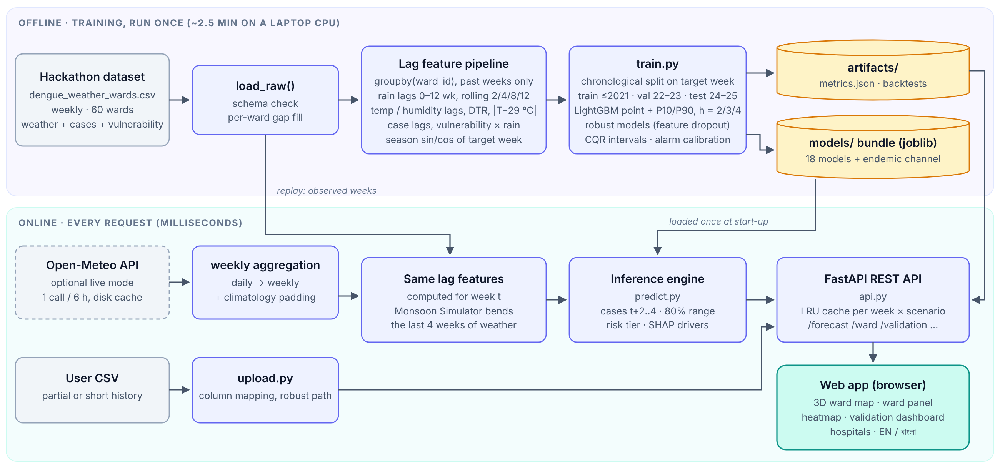
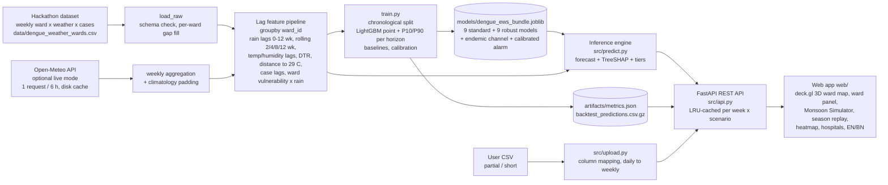
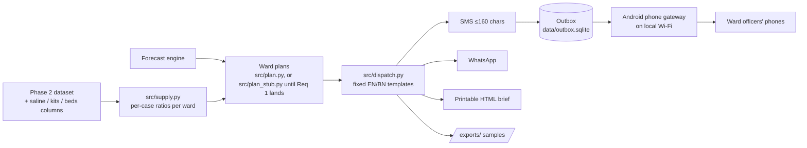

# Architecture: Shotorko, the ward-level dengue early-warning system (Team TRIGUN)

**Goal:** forecast weekly dengue cases and a risk tier (Low / Medium / High / Critical) for each of 60 city-corporation wards **2, 3 and 4 weeks ahead**, so public-health officers can start larval control before an outbreak peaks.

## 1. System data flow



<details><summary>Same diagram as Mermaid source (renders on github.com)</summary>



</details>

Training runs offline once, in about 2.5 minutes on a laptop CPU (standard + robust models). The API server only **loads** the serialized bundle and runs inference on request: all 60 wards × 3 horizons take about 50–70 ms, and a what-if scenario for every ward about 0.4 s. The browser client is plain HTML/JS with deck.gl vendored in the repo, so there is no build step and no Node.js.

## 2. Feature design (the "breeding clock")

At each reference week *t*, every feature uses only data up to *t*, computed with `groupby("ward_id")` so lags never cross wards. For horizon *h*, the label is the case count at *t + h*, so a feature lagged *k* weeks is **k + h weeks before the forecast week**. With 0–12-week rainfall lags, the model covers the 2–4-week egg → adult → incubation lag described in the brief, plus longer-lasting standing water.

| Group | Features |
|---|---|
| Rainfall | `rain_lag0..12`, rolling sums 2/4/8/12 wk, breeding-window sum (t-1..t-3), heavy-rain weeks (>P95 of training) |
| Temperature | `temp_lag0..8`, max/min lags 0..4, 4-wk mean, diurnal range, distance from 29 °C (Aedes transmission optimum, Mordecai et al. 2017) |
| Humidity | `hum_lag0..6`, 4-wk mean |
| Recent cases | lags 0..4, 4-wk mean, 2-wk trend, same week last year |
| Ward vulnerability | population density, water-logging index, sanitation score, **water-logging × rain** and **poor sanitation × rain** interactions (same rain, different drainage) |
| Season | sin/cos of the target week of year |

`tests/test_pipeline.py` checks that the lags are correct, that no ward borrows another ward's history, that tampering with future rows leaves week-*t* features unchanged (no leakage), and that targets sit exactly *h* weeks ahead.

## 3. Chronological validation split

The split is on the **target week (t + h)**. The data is never shuffled.

| Split | Target weeks | Purpose |
|---|---|---|
| Train | 2016 – 2021 | fit candidate models |
| Validation | 2022 – 2023 | early stopping, model choice, NB dispersion, alarm threshold, conformal interval margin |
| **Test** | **2024 – 2025** | reported once; never used for any decision |

The deployed model is refit on train + validation with the chosen settings and tree counts. The endemic channel is learned from 2016–2023 only.

## 4. Model selection rationale

* **LightGBM with Poisson/Tweedie loss.** Weekly counts are non-negative, zero-inflated (58% zeros) and over-dispersed, and a log link fits multiplicative weather effects. Trees capture non-linear, threshold-like responses (inverted-U temperature, flushing by extreme rain) and vulnerability × weather interactions without hand-built splines. One **direct model per horizon** avoids compounding errors from recursive forecasting. Three loss/complexity candidates were compared on validation MAE.
* **Quantile LightGBM (P10/P90) plus conformal calibration** (Romano et al. 2019) gives 80% prediction intervals. Raw quantile coverage on the test years was 65–74%. After calibration on validation it is **85%**.
* **Baselines kept for honesty:** a Poisson GLM on the same features, seasonal naive, persistence, and an ablation without case lags.

**Test-set results (2024–2025, 6,300 ward-weeks per horizon, MAE / RMSE in cases per ward-week)**

| Model | 2 weeks | 3 weeks | 4 weeks |
|---|---|---|---|
| **LightGBM (deployed)** | **0.99 / 1.97** | **1.04 / 2.06** | **1.16 / 2.30** |
| LightGBM weather-only (no case lags) | 1.00 / 1.99 | 1.04 / 2.05 | 1.19 / 2.35 |
| Poisson GLM | 1.11 / 2.43 | 1.25 / 2.74 | 1.45 / 2.87 |
| Seasonal naive (same week last year) | 1.69 / 3.58 | 1.69 / 3.58 | 1.69 / 3.58 |
| Persistence (last week's cases) | 1.66 / 3.30 | 1.87 / 3.58 | 2.06 / 3.85 |

The deployed model has 31–41% lower MAE than seasonal naive. The weather-only ablation scores almost the same, which shows that lagged weather and ward vulnerability carry the predictive signal. This is why the model can still produce a useful outlook in live mode, where no current case feed is connected.

**Incomplete data:** a second, *robust* model per horizon is trained with feature-group dropout, so partial or short inputs still work. With only rain and temperature for 8 weeks it reaches MAE 1.11, against 1.83 for the standard model and 1.30 for a no-data seasonal average. Split distributions, per-split accuracy and all ten completeness scenarios are in [docs/MODEL_REPORT.md](docs/MODEL_REPORT.md).

## 5. Risk tiers (WHO/TDR EWARS-style)

1. **Endemic channel:** for each ward and ISO week, the seasonal mean and SD of cases (±1 week smoothing), from training years only.
2. **Thresholds:** T_medium = mean + 0.5 SD, **T_high = mean + 1.25 SD** (the EWARS endemic-channel upper limit, z = 1.25), and T_critical = mean + 2 SD. Each has a small floor, and each is capped at the training P75 / P90 / P97, so a very high burden is flagged even in peak season.
3. **Outbreak probability:** counts are treated as Negative Binomial(μ, r), with r estimated from validation residuals. The **risk score** is 100 × P(cases > T_high).
4. **Tier** = the highest level whose exceedance probability is at least the alarm cut. The cut is calibrated per horizon on the validation years by maximising F1 of High+ alerts (selected values: 0.30 / 0.225 / 0.225).

On the test years (where only 4.5% of ward-weeks are observed High+), the system catches **71% / 86% / 84%** of High+ weeks 2 / 3 / 4 weeks ahead, with precision 36% / 30% / 25%. That is roughly 5–8× the base rate. The predicted tier is within one level of the observed tier in **97%** of ward-weeks.

## 6. Compute and API cost controls

* **Serialized models:** one `joblib` bundle, loaded once when the server starts. Inference is CPU-only (about 50–70 ms for all wards and horizons). `/api/forecast` results are memoised with an LRU cache keyed on (week, scenario, mode), so replaying a week costs nothing. What-if scenarios rebuild features only for the 65-week window they need. The client debounces slider input (≈0.3 s) and sends one request per change.
* **Explanations without a paid API:** per-forecast driver attributions use LightGBM's built-in TreeSHAP (`pred_contrib=True`). The narrative text comes from a deterministic template. **Runtime LLM tokens: 0.** If an LLM summary is added later, the plan is: one cached summary per ward-week (keyed by forecast hash), a `max_tokens` cap of about 150, generated only on demand, with the template as fallback.
* **Weather API (optional live mode):** Open-Meteo is free and needs no key. **One request** covers all 5 cities (comma-separated coordinates), with a disk cache TTL of 6 h, so at most 4 calls per day. It has a 10 s timeout and one retry, falls back to a stale cache or to replay mode if the API fails, and the UI shows the call and cache-hit counters.
* **Training is not part of app start-up.** The trained bundle, deck.gl, the map outlines and the fonts ship in the repo, so a fresh clone installs and launches in about a minute. The only optional internet call at runtime is the cached Open-Meteo request (section 11).

## 7. Hospital readiness

For High or Critical wards, the panel lists the city's dengue-treating public hospitals with the city's forecast load against normal and the DGHS line 16263. No open real-time bed feed exists, so pressure is forecast-based (details in docs/MODEL_REPORT.md).

## 8. Phase 2 operations: supply allocation and hospital overflow (requirements 1–2)

Both modules run on the same cached forecast as the map (`/api/forecast`), in plain numpy/pandas, with no network and no LLM. Code: `src/resources.py`, `src/surge.py`, `src/ops_api.py`; UI: the **Operations** tab (`web/ops.js`). Both modules feed the team's shared **ward plan** format (`src/plan.py`, `GET /api/plan`, `POST /api/plan/simulate`; spec in `docs/PHASE2_PLAN_CONTRACT.md`), which the dispatch notices read. Tests: `tests/test_operations.py` and `tests/test_plan.py` (every contract rule, plus kill-switch tests that block every outbound socket).

```
forecast (cases, 80% upper, tier) ──► supply rule ──► demand per ward ──► priority water-filling ──► allocation + deficit flags
                                                     └► bed demand ──► vs local capacity ──► intra-city routing ──► transfers + city utilisation
```

**Supply rule, fitted from the onsite data.** In the onsite dataset each supply column is an exact function of `dengue_cases`. A grid search (`fit_ratio`) finds ratios that reproduce **all 31,320 rows exactly** (round half up):
saline = round(cases × 2.385), kits = round(cases × 1.165), beds = round(cases × 0.298).
For predicted cases the same ratios are used but rounded **up** (ceil), as the ward-plan contract specifies, so a ward is never planned short by rounding. Ward plans use the expected count; the Operations tab can also plan on the 80% upper bound ("worst case").

**Requirement 1: constrained allocation.**
* Priority weight per ward = tier weight (Low 1, Medium 2, High 3, Critical 4) × population density ÷ mean density.
* Available stock is set as 30–100% of total projected need (one slider for all three items). It is rounded down, so the total allocated never exceeds that percentage.
* *Share by priority* (default): find the level L so that Σ demand_i × min(1, L × w_i) = stock. The highest-weight wards are filled to 100% first, and every other ward gets a share proportional to its weight. Whole units come from the largest-remainder method, so the allocated total equals the stock exactly. *Strict triage* is the alternative: wards are filled completely, one by one, in priority order.
* Spraying crews needed per ward-week: Low 0, Medium 1, High 2, Critical 3, plus 1 for wards denser than 60,000/km². Crews are shared with the same rule against the "Total spraying crews" slider.
* Deficit flags: any ward below 100% of need is flagged (`partial`). It is **critical** if any item is under 50% covered.
* **Minimum for every ward (lifeline, 0–50%):** before priority sharing, every ward first gets at least this share of each supply (crews still follow priority only). At 50% no ward can be in critical deficit as long as stock covers the minimums; if it can't, every ward gets an equal share instead. At 60% stock on 7 Jul 2025 this takes critical wards from 31 to 0, at the cost of the top wards no longer being fully covered.
* **What it takes:** for each item, a binary search finds the smallest stock with no critical ward under the current rules (allocation only grows with stock, so the search is exact). The page shows the gap ("+516 saline bags, +255 kits, +71 beds, about 93% stock") with one-click buttons to try that stock or to turn on the 50% minimum.
* **Real warehouse counts:** officers can type the actual number of saline bags, kits and beds in stock; each count replaces the stock slider for that item (`saline_stock`, `kits_stock`, `beds_stock` on `/api/ops/allocate`).

**Requirement 2: hospital surge and overflow routing.**
* Local dengue bed capacity per ward = the 95th percentile of its weekly `hospital_beds_required` in 2016–2023 (at least 2 beds), times a capacity slider (50–200%). These are the train + validation years the deployed model and the risk tiers are fitted on, so the 2024–25 test years never leak in. The dataset has no bed counts, so this is the load a ward normally absorbs in a busy week; real counts can replace it.
* Wards whose bed demand exceeds capacity send the overflow, one patient at a time, to the ward **in the same city** with the lowest bed use after receiving that patient (the nearer ward wins ties). An overflowing ward never receives, a receiver never goes above 100%, and nobody crosses a city pool.
* **Reserve (floating) beds:** officers can give each city a few beds that belong to no ward (field cots, a mobile team). They are used only after transfers, for patients no existing bed in the city can take, and open at the ward where those patients are. They never cross cities. Each escalation warning has a one-click "Open N reserve beds" button, and ward plans carry `overflow.floating_beds`.
* Overflow still left after that is reported as unresolved, with an escalation warning (more reserve beds or referral out).
* Outputs: each ward's net deficit or spare beds, the patients it sent and received, its bed use after routing, a transfer list (from → to, patients, schematic km), and each city's capacity, bed use before and after, and remaining spare beds. Both tables export as CSV.
* On the 105 test weeks of 2024–25 (using the real case counts), at least one ward exceeds capacity in 20% of weeks, routing resolves most of these, and 4% of weeks still need escalation. Tighter rules (90th percentile: 15% of weeks escalate) or looser ones (the highest week ever: overflow in 1% of weeks) were rejected.

## 9. Phase 2 vector-control simulator (requirement 3)

Code: `src/simulation.py` (model), `src/vector_sim.py` (the hook `src/plan.py` calls on `POST /api/plan/simulate`), `POST /api/simulate` and `GET /api/simulate/roi` in `src/api.py`; UI: the **Crew simulator** tab (`web/sim.js`). Tests: `tests/test_simulation.py`. Offline and deterministic.

```
feature row (ward, week t) ─┬─► LightGBM h=2,3,4 ─► cases without crews ─┐
                            └─► crew effect on the features ─► LightGBM ─► cases with crews ─┴─► prevented, beds, saline, ROI
```

**Model-driven counterfactual, not a fixed %.** For each ward and horizon the deployed forecast models run twice: once on the real features, once on the features the crews' work would produce. The difference, summed over weeks +2…+4, is `cases_prevented`; beds and saline use Requirement 1's ratios (`SUPPLY_RATIOS`), so they match the Operations tab. The same crew prevents more in a waterlogged ward after heavy rain than in a dry-season ward, because that is what the model learned.

**Two crew types** (fogging is deliberately not offered: no proven case reduction in trials, and Dhaka *Aedes* is highly pyrethroid-resistant):

| Crew | What it changes in the model | Size of effect | Timing |
|---|---|---|---|
| Larvicide / source reduction | breeding-water features (rain lags and totals, water-logging, sanitation gap, their rain interactions) | each crew treats 20% of the remaining habitat (guess); at full coverage the central setting removes 35% of effective breeding water, which gives ~28% fewer model cases in peak weeks, matching the 29.5% of the Camino Verde RCT | nothing in week 1, half by week 2, full from week 3 |
| Targeted indoor spraying (non-pyrethroid) around recent cases | recent-case features (onward transmission) fully, and 40% of that on the breeding-water features (the adult mosquitoes around the treated homes) | each crew covers the homes around ~6 recent cases a week (guess), with diminishing coverage when cases are many; 50% ward-level effect at full coverage (Cairns: 86–96% at treated premises) | most of the effect in week 1, fading to 70% by week 4; no recent cases means nothing to target |

**Outputs.** Per ward: crews and crew mix, cases prevented with a low/central/high band, beds, saline and kits saved, ROI (cases prevented per crew) with its band, a week-by-week breakdown, and the **cost of waiting one week** (the same crews sent next week). Wards are ranked by ROI for one crew of whichever type works better there.

**Optimiser.** "Auto-plan" gives each crew, one at a time, to the (ward, crew type) where it prevents the most extra cases; a ward keeps one crew type. Because each ward's gains have diminishing returns, this greedy plan is near-optimal for the modelled gains, and it beats sending one crew to each of the top-ROI wards. In peak season it mostly picks larvicide (rain drives the forecast); outside the season it picks indoor spraying where a few recent cases can be chased.

**Money view.** Treatment cost avoided = cases prevented × hospitalised share (0.298, Requirement 1's bed ratio) × BDT 39,893, the societal cost of one hospitalised dengue episode in Dhaka (Sarker et al., *PLOS NTD* 2023, PMC10723663, 2019 data). Crew cost per 2–4 week deployment is an estimate (larvicide BDT 100,000, indoor spraying BDT 120,000: 5 workers × BDT 800/day × 18 days plus chemicals). Outputs: money saved, crew cost, net benefit, benefit/cost ratio and crew cost per case prevented. All three costs are editable in the UI and the API (`costs`). Savings are a floor, because outpatient costs and lost work days are not counted.

**Model check** (`GET /api/simulate/check`, shown in the tab). On the out-of-sample test weeks of 2024–25, keeping 90 / 75 / 50% of the breeding-water features lowers the forecast by 8 / 23 / 48%, and 87–91% of ward-weeks never go up (the rest is tree-model noise, floored at zero per ward). Halving the recent-case features lowers it by only 2%, so in this dataset weather drives cases far more than case momentum. The raw data agrees: 4-week rain vs cases 3 weeks later has Spearman 0.77, and ward water-logging vs mean cases has 0.81. The onsite dataset adds only the three supply columns; the model's 12 input columns are identical to Phase 1, so the deployed model and its backtest still apply without retraining.

**Limits.** Effect sizes are calibrated from published trials, not measured in these wards; crew coverage and the onset curves are stated guesses. The model has no crew history to learn from, so the simulator shows the model's response to changed inputs, with the uncertainty band, rather than a validated causal effect.

**References for this section:** Andersson et al., Camino Verde cluster RCT, *BMJ* 2015 (PMC4495677); Vazquez-Prokopec et al., *Sci Adv* 2017, Cairns targeted indoor spraying (PMC5315446); Bowman et al. 2016, systematic review of vector control (PMC4795802); pyrethroid resistance of Dhaka *Aedes aegypti* (PubMed 36942761); Hladish et al., *PLOS NTD* 2018, timing of indoor spraying (PMC6042783).

## 10. Phase 2: dispatch notices and SMS (requirement 4)



* **Ward plan contract.** Notices never compute supplies themselves; they read one *ward plan* per ward with `required`, `allocated`, `deficit`, `coverage_pct`, `deficit_level`, `priority_rank` and `spray_teams` (full spec: [docs/PHASE2_PLAN_CONTRACT.md](docs/PHASE2_PLAN_CONTRACT.md)). Notices use the real allocation engine (`src/plan.py`, section 8) through `/api/plan`; `src/plan_stub.py` (`source: "stub"`, simple ratio-based plans) is kept only as a fallback for a checkout without `src/plan.py`.
* **Channels.** `src/dispatch.py` renders the same notice three ways from fixed English and Bangla templates (no LLM): an SMS kept in one 160-character GSM segment in English (Bangla is Unicode, 70 characters per part, and the segment count is shown); a WhatsApp alert with bold labels; and a one-page printable commissioner brief (supplies table, deficit alert, action, referral hospitals, signature lines) that saves as PDF from the browser. `python -m src.export_samples` writes all three, in both languages, to `exports/`.
* **Dispatch centre** (`web/dispatch.html`, linked from the dashboard's Operations strip): week, horizon, regional stock and crew controls; wards in priority order with deficit badges; per-ward SMS / WhatsApp / brief previews; copy, send and print.
* **Automatic SMS without a paid gateway.** `src/sms_gateway.py` sends through an Android phone running the open-source *SMS Gateway for Android* app in local-server mode: Shotorko posts each message to the phone over the local Wi-Fi or the phone's hotspot, and the phone sends it from its own SIM. Every message goes through a local SQLite outbox (`queued → sending → sent → delivered`, or `failed` with the reason); one background worker sends with a pause between messages (Android rate limits), retries up to 3 times, keeps messages queued while the phone is unreachable, and refuses to queue the same notice to the same ward for the same week twice. `SMS_MODE=dry_run` (default) logs without sending; `SMS_OVERRIDE_TO` routes every message to one demo number. Credentials live in `.env` and real phone numbers in `data/ward_contacts.csv`; both are git-ignored.

## 11. Phase 2: offline resilience (requirement 5)

**Everything that decides anything runs on this machine:** the trained model bundle, the dataset, supply plans, dispatch templates, the outbox and every web asset (deck.gl, Natural Earth outlines and the fonts are all bundled; the pages reference no internet URL). Runtime LLM calls: 0.

| Component | Needs internet? | When the internet is gone |
|---|---|---|
| Forecasts, drivers, simulator, model trust | No | Unchanged |
| Supply plans and deficit alerts | No | Unchanged |
| Dispatch notices (SMS, WhatsApp, brief) and `/exports` | No | Unchanged |
| SMS sending | No (phone on local Wi-Fi/hotspot; SMS goes over the mobile network) | Unchanged; if the phone itself is unreachable, messages wait in the outbox |
| Live weather (optional) | Yes (Open-Meteo) | Uses the last cached weather; with no cache it fails in milliseconds and the UI returns to replay mode |

* **Kill switch.** `SHOTORKO_OFFLINE=1` forbids every internet request. Without it, a 1.5 s connectivity probe (cached 30 s) stops the app from waiting on long HTTP timeouts when Wi-Fi is up but the internet is not.
* **Visible state.** `/api/health` reports `offline_forced`, `internet`, what runs locally and the state of the optional services; both pages show an "Offline · local mode" badge.
* **Proof.** `tests/test_offline.py` cuts the network at the socket level (only loopback allowed), forces offline mode and checks: health, meta, forecast, ward explanations, supply plans (allocated ≤ required, deficits appear at 50% stock), dispatch in every channel and both languages (English SMS ≤160 characters, briefs load nothing remote), live weather degrades without a 500, the SMS queue works in dry run, the export script runs, **no connection attempt is made**, and the web files contain no internet URLs.

* **In-app switch.** A "Simulate offline" button in the header (`POST /api/offline`) turns the kill switch on and off live, so the judges' test can be shown without unplugging anything.
* **Honest freshness.** In live mode the dashboard says where the weather came from and how old it is ("Live weather from 27 Nov 10:02 (2.2 h ago) · saved copy"); `/api/forecast?mode=live` returns the same in its `weather` block.
* **Installing with no internet.** `scripts/make_offline_bundle.*` downloads every Python package into `wheels/` once (about 80 MB, not committed); `scripts/install_offline.*` installs from that folder only (`--no-index`). Verified with pip's network deliberately broken: a fresh install completed in about 2 minutes.

To check by hand: `SHOTORKO_OFFLINE=1 python run.py` (PowerShell: `$env:SHOTORKO_OFFLINE="1"; python run.py`), or simply turn Wi-Fi off and use the app.

## 12. Limitations and next steps

The organiser data looks synthetic (about 10k cases a year, while DGHS reports over 100k), so the accuracy numbers describe this dataset only. Ward IDs do not match official boundaries, so the map is schematic. Live mode uses real weather but seasonal-normal case counts until a DGHS case feed is connected. The next steps are a DGHS daily feed, Breteau-index larval surveys as an extra feature, and real ward polygons.

**References:** Mordecai et al., *PLOS NTD* 2017 (thermal optimum 29 °C); Sharmin et al., *PLOS NTD* 2015 (Dhaka climate–dengue lags); Hashizume et al., *BMC Infect Dis* 2012 (Dhaka hydro-climate and dengue); Hussain-Alkhateeb et al., *PLOS ONE* 2018 and the WHO/TDR EWARS operational guide (endemic channel, z = 1.0–1.5); Romano et al., NeurIPS 2019 (conformalized quantile regression); Open-Meteo (CC BY 4.0).
