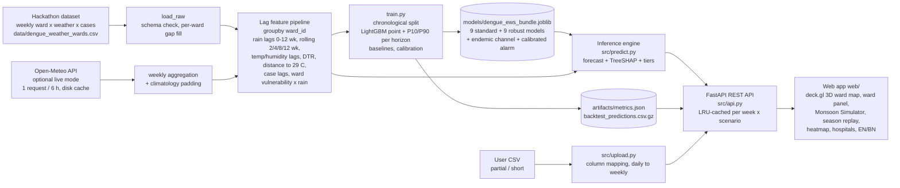
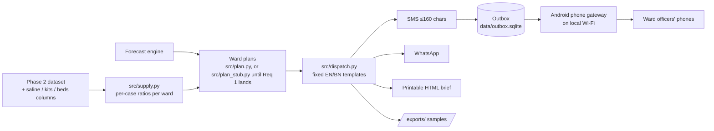

# Architecture: Shotorko, the ward-level dengue early-warning system (Team TRIGUN)

**Goal:** forecast weekly dengue cases and a risk tier (Low / Medium / High / Critical) for each of 60 city-corporation wards **2, 3 and 4 weeks ahead**, so public-health officers can start larval control before an outbreak peaks.

## 1. System data flow

Same diagram as Mermaid source (renders on github.com)

Training runs offline once, in about 2.5 minutes on a laptop CPU (standard + robust models). The API server only **loads** the serialized bundle and runs inference on request: all 60 wards × 3 horizons take about 50–70 ms, and a what-if scenario for every ward about 0.4 s. The browser client is plain HTML/JS with deck.gl vendored in the repo, so there is no build step and no Node.js.

## 2. Feature design (the "breeding clock")

At each reference week *t*, every feature uses only data up to *t*, computed with `groupby("ward_id")` so lags never cross wards. For horizon *h*, the label is the case count at *t + h*, so a feature lagged *k* weeks is **k + h weeks before the forecast week**. With 0–12-week rainfall lags, the model covers the 2–4-week egg → adult → incubation lag described in the brief, plus longer-lasting standing water.

| Group | Features |
|---|---|
| Rainfall | `rain_lag0..12`, rolling sums 2/4/8/12 wk, breeding-window sum (t-1..t-3), heavy-rain weeks (>P95 of training) |
| Temperature | `temp_lag0..8`, max/min lags 0..4, 4-wk mean, diurnal range, distance from 29 °C (Aedes transmission optimum, Mordecai et al. 2017) |
| Humidity | `hum_lag0..6`, 4-wk mean |
| Recent cases | lags 0..4, 4-wk mean, 2-wk trend, same week last year |
| Ward vulnerability | population density, water-logging index, sanitation score, **water-logging × rain** and **poor sanitation × rain** interactions (same rain, different drainage) |
| Season | sin/cos of the target week of year |

`tests/test_pipeline.py` checks that the lags are correct, that no ward borrows another ward's history, that tampering with future rows leaves week-*t* features unchanged (no leakage), and that targets sit exactly *h* weeks ahead.

## 3. Chronological validation split

The split is on the **target week (t + h)**. The data is never shuffled.

| Split | Target weeks | Purpose |
|---|---|---|
| Train | 2016 – 2021 | fit candidate models |
| Validation | 2022 – 2023 | early stopping, model choice, NB dispersion, alarm threshold, conformal interval margin |
| **Test** | **2024 – 2025** | reported once; never used for any decision |

The deployed model is refit on train + validation with the chosen settings and tree counts. The endemic channel is learned from 2016–2023 only.

## 4. Model selection rationale

* **LightGBM with Poisson/Tweedie loss.** Weekly counts are non-negative, zero-inflated (58% zeros) and over-dispersed, and a log link fits multiplicative weather effects. Trees capture non-linear, threshold-like responses (inverted-U temperature, flushing by extreme rain) and vulnerability × weather interactions without hand-built splines. One **direct model per horizon** avoids compounding errors from recursive forecasting. Three loss/complexity candidates were compared on validation MAE.
* **Quantile LightGBM (P10/P90) plus conformal calibration** (Romano et al. 2019) gives 80% prediction intervals. Raw quantile coverage on the test years was 65–74%. After calibration on validation it is **85%**.
* **Baselines kept for honesty:** a Poisson GLM on the same features, seasonal naive, persistence, and an ablation without case lags.

**Test-set results (2024–2025, 6,300 ward-weeks per horizon, MAE / RMSE in cases per ward-week)**

| Model | 2 weeks | 3 weeks | 4 weeks |
|---|---|---|---|
| **LightGBM (deployed)** | **0.99 / 1.97** | **1.04 / 2.06** | **1.16 / 2.30** |
| LightGBM weather-only (no case lags) | 1.00 / 1.99 | 1.04 / 2.05 | 1.19 / 2.35 |
| Poisson GLM | 1.11 / 2.43 | 1.25 / 2.74 | 1.45 / 2.87 |
| Seasonal naive (same week last year) | 1.69 / 3.58 | 1.69 / 3.58 | 1.69 / 3.58 |
| Persistence (last week's cases) | 1.66 / 3.30 | 1.87 / 3.58 | 2.06 / 3.85 |

The deployed model has 31–41% lower MAE than seasonal naive. The weather-only ablation scores almost the same, which shows that lagged weather and ward vulnerability carry the predictive signal. This is why the model can still produce a useful outlook in live mode, where no current case feed is connected.

**Incomplete data:** a second, *robust* model per horizon is trained with feature-group dropout, so partial or short inputs still work. With only rain and temperature for 8 weeks it reaches MAE 1.11, against 1.83 for the standard model and 1.30 for a no-data seasonal average. Split distributions, per-split accuracy and all ten completeness scenarios are in [docs/MODEL_REPORT.md](docs/MODEL_REPORT.md).

## 5. Risk tiers (WHO/TDR EWARS-style)

1. **Endemic channel:** for each ward and ISO week, the seasonal mean and SD of cases (±1 week smoothing), from training years only.
2. **Thresholds:** T_medium = mean + 0.5 SD, **T_high = mean + 1.25 SD** (the EWARS endemic-channel upper limit, z = 1.25), and T_critical = mean + 2 SD. Each has a small floor, and each is capped at the training P75 / P90 / P97, so a very high burden is flagged even in peak season.
3. **Outbreak probability:** counts are treated as Negative Binomial(μ, r), with r estimated from validation residuals. The **risk score** is 100 × P(cases > T_high).
4. **Tier** = the highest level whose exceedance probability is at least the alarm cut. The cut is calibrated per horizon on the validation years by maximising F1 of High+ alerts (selected values: 0.30 / 0.225 / 0.225).

On the test years (where only 4.5% of ward-weeks are observed High+), the system catches **71% / 86% / 84%** of High+ weeks 2 / 3 / 4 weeks ahead, with precision 36% / 30% / 25%. That is roughly 5–8× the base rate. The predicted tier is within one level of the observed tier in **97%** of ward-weeks.

## 6. Compute and API cost controls

* **Serialized models:** one `joblib` bundle, loaded once when the server starts. Inference is CPU-only (about 50–70 ms for all wards and horizons). `/api/forecast` results are memoised with an LRU cache keyed on (week, scenario, mode), so replaying a week costs nothing. What-if scenarios rebuild features only for the 65-week window they need. The client debounces slider input (≈0.3 s) and sends one request per change.
* **Explanations without a paid API:** per-forecast driver attributions use LightGBM's built-in TreeSHAP (`pred_contrib=True`). The narrative text comes from a deterministic template. **Runtime LLM tokens: 0.** If an LLM summary is added later, the plan is: one cached summary per ward-week (keyed by forecast hash), a `max_tokens` cap of about 150, generated only on demand, with the template as fallback.
* **Weather API (optional live mode):** Open-Meteo is free and needs no key. **One request** covers all 5 cities (comma-separated coordinates), with a disk cache TTL of 6 h, so at most 4 calls per day. It has a 10 s timeout and one retry, falls back to a stale cache or to replay mode if the API fails, and the UI shows the call and cache-hit counters.
* **Training is not part of app start-up.** The trained bundle, deck.gl, the map outlines and the fonts ship in the repo, so a fresh clone installs and launches in about a minute. The only optional internet call at runtime is the cached Open-Meteo request (section 9).

## 7. Hospital readiness

For High or Critical wards, the panel lists the city's dengue-treating public hospitals with the city's forecast load against normal and the DGHS line 16263. No open real-time bed feed exists, so pressure is forecast-based (details in docs/MODEL_REPORT.md).

## 8. Phase 2: dispatch notices and SMS (Requirement 4)

* **Ward plan contract.** Notices never compute supplies themselves; they read one *ward plan* per ward with `required`, `allocated`, `deficit`, `coverage_pct`, `deficit_level`, `priority_rank` and `spray_teams` (full spec: [docs/PHASE2_PLAN_CONTRACT.md](docs/PHASE2_PLAN_CONTRACT.md)). Until the allocation engine (Requirement 1) is committed as `src/plan.py`, a clearly labelled stand-in (`src/plan_stub.py`, `source: "stub"`) fills the plan: required = forecast cases × per-ward supply ratios learned from the Phase 2 columns (train + validation years only); allocated = a stock pool of `stock_pct` % handed out in priority order (tier, risk score, population density); crews by tier. Requirement 1 replaces it automatically.
* **Channels.** `src/dispatch.py` renders the same notice three ways from fixed English and Bangla templates (no LLM): an SMS kept in one 160-character GSM segment in English (Bangla is Unicode, 70 characters per part, and the segment count is shown); a WhatsApp alert with bold labels; and a one-page printable commissioner brief (supplies table, deficit alert, action, referral hospitals, signature lines) that saves as PDF from the browser. `python -m src.export_samples` writes all three, in both languages, to `exports/`.
* **Dispatch centre** (`web/dispatch.html`, linked from the dashboard's Operations strip): week, horizon, regional stock and crew controls; wards in priority order with deficit badges; per-ward SMS / WhatsApp / brief previews; copy, send and print.
* **Automatic SMS without a paid gateway.** `src/sms_gateway.py` sends through an Android phone running the open-source *SMS Gateway for Android* app in local-server mode: Shotorko posts each message to the phone over the local Wi-Fi or the phone's hotspot, and the phone sends it from its own SIM. Every message goes through a local SQLite outbox (`queued → sending → sent → delivered`, or `failed` with the reason); one background worker sends with a pause between messages (Android rate limits), retries up to 3 times, keeps messages queued while the phone is unreachable, and refuses to queue the same notice to the same ward for the same week twice. `SMS_MODE=dry_run` (default) logs without sending; `SMS_OVERRIDE_TO` routes every message to one demo number. Credentials live in `.env` and real phone numbers in `data/ward_contacts.csv`; both are git-ignored.

## 9. Phase 2: offline resilience (Requirement 5)

**Everything that decides anything runs on this machine:** the trained model bundle, the dataset, supply plans, dispatch templates, the outbox and every web asset (deck.gl, Natural Earth outlines and the fonts are all bundled; the pages reference no internet URL). Runtime LLM calls: 0.

| Component | Needs internet? | When the internet is gone |
|---|---|---|
| Forecasts, drivers, simulator, model trust | No | Unchanged |
| Supply plans and deficit alerts | No | Unchanged |
| Dispatch notices (SMS, WhatsApp, brief) and `/exports` | No | Unchanged |
| SMS sending | No (phone on local Wi-Fi/hotspot; SMS goes over the mobile network) | Unchanged; if the phone itself is unreachable, messages wait in the outbox |
| Live weather (optional) | Yes (Open-Meteo) | Uses the last cached weather; with no cache it fails in milliseconds and the UI returns to replay mode |

* **Kill switch.** `SHOTORKO_OFFLINE=1` forbids every internet request. Without it, a 1.5 s connectivity probe (cached 30 s) stops the app from waiting on long HTTP timeouts when Wi-Fi is up but the internet is not.
* **Visible state.** `/api/health` reports `offline_forced`, `internet`, what runs locally and the state of the optional services; both pages show an "Offline · local mode" badge.
* **Proof.** `tests/test_offline.py` cuts the network at the socket level (only loopback allowed), forces offline mode and checks: health, meta, forecast, ward explanations, supply plans (allocated ≤ required, deficits appear at 50% stock), dispatch in every channel and both languages (English SMS ≤160 characters, briefs load nothing remote), live weather degrades without a 500, the SMS queue works in dry run, the export script runs, **no connection attempt is made**, and the web files contain no internet URLs.

To check by hand: `SHOTORKO_OFFLINE=1 python run.py` (PowerShell: `$env:SHOTORKO_OFFLINE="1"; python run.py`), or simply turn Wi-Fi off and use the app.

## 10. Limitations and next steps

The organiser data looks synthetic (about 10k cases a year, while DGHS reports over 100k), so the accuracy numbers describe this dataset only. Ward IDs do not match official boundaries, so the map is schematic. Live mode uses real weather but seasonal-normal case counts until a DGHS case feed is connected. The next steps are a DGHS daily feed, Breteau-index larval surveys as an extra feature, and real ward polygons.

**References:** Mordecai et al., *PLOS NTD* 2017 (thermal optimum 29 °C); Sharmin et al., *PLOS NTD* 2015 (Dhaka climate–dengue lags); Hashizume et al., *BMC Infect Dis* 2012 (Dhaka hydro-climate and dengue); Hussain-Alkhateeb et al., *PLOS ONE* 2018 and the WHO/TDR EWARS operational guide (endemic channel, z = 1.0–1.5); Romano et al., NeurIPS 2019 (conformalized quantile regression); Open-Meteo (CC BY 4.0).
